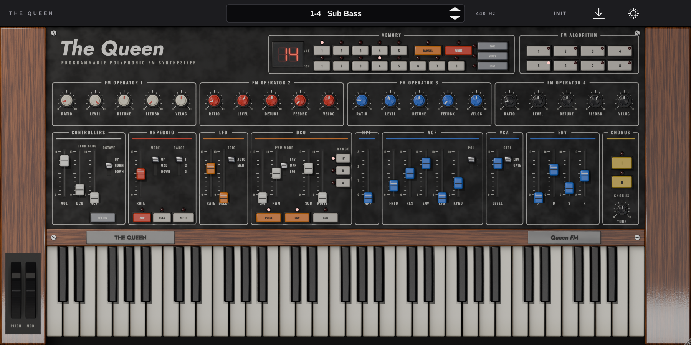

# The Queen

4-operator FM + Juno-60-style polysynth (6 voices) with a photoreal panel rendered from
`queen_blender/THE_QUEEN.blend`. Formats: AU (macOS), VST3, CLAP, Standalone. JUCE 8.0.15 on the
[Pamplejuce](https://github.com/sudara/pamplejuce) template.



> The repository also contains `ace_rack_mount/`, an unrelated project.

## Install (Mac, no tools needed)

1. Download **The Queen Installer.pkg** from the
   [Mac installer release](https://github.com/Shaytownsend/Wonderland/releases/tag/mac-latest).
2. Double-click it and click through the installer.
   First time only: if macOS says it can't verify the developer, open
   **System Settings → Privacy & Security**, scroll down, click **Open Anyway**, then open the installer again.
3. Open your DAW and pick **The Queen** (Lance Shipp) as an instrument, or open **The Queen** from Applications.

It installs AU / VST3 / CLAP into `/Library/Audio/Plug-Ins` and the standalone app into `/Applications`.
The installer is rebuilt automatically by GitHub (`.github/workflows/mac-installer.yml`) on every push.

## Build from source (developers)

Requirements: CMake ≥ 3.25, Ninja, Xcode 16 command line tools (macOS 13+), Python 3 for the asset tools.

```bash
git submodule update --init --recursive
```

```bash
cmake -B build -G Xcode -DCMAKE_BUILD_TYPE=Release && cmake --build build --config Release
```

```bash
ctest --test-dir build -C Release
```

```bash
build/install.sh
```

`build/install.sh` copies the AU, VST3 and CLAP into `~/Library/Audio/Plug-Ins/{Components,VST3,CLAP}`
(on Linux: `~/.vst3`, `~/.clap`) and ad-hoc signs the AU. On Linux use `-G Ninja` instead of `-G Xcode`
(AU is skipped automatically).

Validation on a Mac (ad-hoc codesign, `auval -v aumu Quen Lshp`, pluginval strictness 8 on AU + VST3,
Standalone CPU with `top`):

```bash
tools/validate_mac.sh
```

Hidden tests: `build/Tests "[.cpu]"` (DSP load, 6 notes, 48 kHz/128) and
`QUEEN_SNAPSHOT=docs/ui.png build/Tests "[.snapshot]"` (headless editor screenshot).

## Layout of the code

| Path | What |
| --- | --- |
| `source/Parameters.h` | the one table every parameter comes from (ids, ranges, defaults, groups) |
| `source/dsp/` | FM operators + 8 algorithms, Juno filter/env/LFO/chorus, arpeggiator, `SynthEngine` |
| `source/state/PatchMemory.*` | 5 banks × 8 patches, MANUAL/WRITE, `.queen` save/verify/load, factory bank |
| `source/gui/` | `layout.json` reader, filmstrip LookAndFeel, panel controls, host bar, sprite keyboard |
| `queen_blender/` | the scene, its packed textures, and `tex2/J.json` (the control registry) |
| `tools/` | registry → layout, Blender asset export, placeholders, install/validate scripts |

## Re-rendering the GUI assets

All sprite names/sizes are defined in `tools/sprites.py`; the editor reads positions from
`assets/layout.json`, so new renders need no code changes.

```bash
python3 -m venv .venv && .venv/bin/pip install bpy pillow
```

1. If the scene's controls moved, regenerate the registry (`queen_blender/tex2/J.json`):

   ```bash
   .venv/bin/python queen_blender/scripts/extract_registry.py
   ```

2. Regenerate `assets/layout.json`:

   ```bash
   python3 tools/make_layout.py
   ```

3. Render everything into `assets/` (Cycles, 24 samples + denoise; uses Metal/CUDA/OptiX if available,
   otherwise CPU, about 12 minutes on 4 cores). `--only knob,button` re-renders some kinds; `--out dir`
   renders elsewhere:

   ```bash
   .venv/bin/python tools/export_assets.py
   ```

4. Rebuild. `tests/AssetsTest` fails if placeholder art (from `tools/make_placeholders.py`) is embedded.

`tools/render_reference.py out.png` renders the untouched scene through the same camera for side-by-side checks.

## Signing and notarizing (later)

Needs a paid Apple Developer account with a "Developer ID Application" certificate (and "Developer ID
Installer" for a .pkg).

1. Sign each bundle with the hardened runtime and a timestamp:

   ```bash
   codesign --force --deep --options runtime --timestamp -s "Developer ID Application: Lance Shipp (TEAMID)" "build/TheQueen_artefacts/Release/AU/The Queen.component"
   ```

   Repeat for `VST3/The Queen.vst3`, `CLAP/The Queen.clap` and `Standalone/The Queen.app`.
2. Zip (or build a signed .pkg with `pkgbuild`/`productbuild --sign "Developer ID Installer: …"`) and submit:

   ```bash
   xcrun notarytool submit TheQueen.zip --apple-id you@example.com --team-id TEAMID --password APP_SPECIFIC_PASSWORD --wait
   ```

3. Staple the ticket to each bundle (or to the .pkg):

   ```bash
   xcrun stapler staple "build/TheQueen_artefacts/Release/AU/The Queen.component"
   ```

4. Check: `spctl -a -vvv -t install <bundle>` should report `source=Notarized Developer ID`.

Pamplejuce's `.github/workflows.disabled/build_and_test.yml` shows the same steps for CI if you ever re-enable it.
